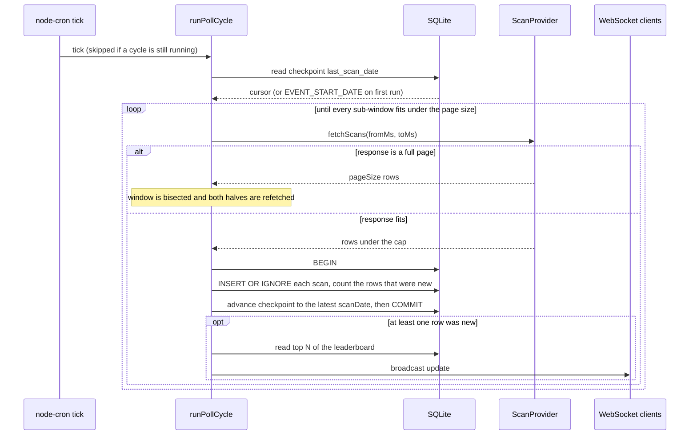
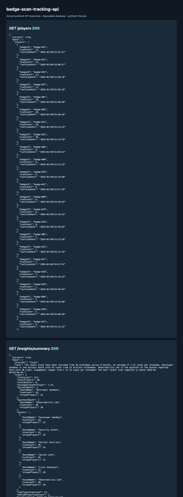

# Badge Scan Tracking API

Attendees at an event tap their badge at booths, and an upstream scan API is the only thing
that knows about it. This service polls that API on a schedule, keeps a durable per-attendee
scan count in SQLite, and pushes the leaderboard to anyone holding a WebSocket open — so a
screen on the show floor stays current with nobody refreshing it.

## Run it with no credentials

The upstream API sits behind a token, so the scan source is a swappable provider. The `fake`
provider replays a checked-in fixture, so a clone runs offline on the first try:

```bash
npm install
cp .env.example .env     # SCAN_PROVIDER=fake is the default in the example
npm run dev
```

```console
$ curl -s localhost:3000/metrics | jq '.data.poll'
{ "cyclesSucceeded": 1, "cyclesFailed": 0, "batchesProcessed": 1,
  "scansSeen": 240, "scansSkippedNoBooth": 19, "scansInserted": 221,
  "lastError": null }
```

Those numbers are the fixture: 240 upstream rows, 19 of which carry no booth name and are
dropped, leaving 221 scans across 30 badges and 6 booths. Point at the live API by setting
`SCAN_PROVIDER=http` and `API_TOKEN` — nothing else changes.

## What one poll cycle does



The cursor advance shares a transaction with the inserts, so a crash between sub-batches
leaves the cursor where it was and the next tick refetches that window. That is harmless:
`INSERT OR IGNORE` on `UNIQUE(badge_id, scan_date)` makes a replay a no-op, and the
per-attendee counter is only bumped when the insert actually created a row.
`src/services/scan.service.test.ts` asserts it — a second cycle over the same window inserts
nothing and leaves every count unchanged.

## Why the poller bisects time instead of paging

The upstream endpoint takes `scanDateGT` and `scanDateLT`, caps a response at `SCAN_PAGE_SIZE`
rows, and offers no cursor and no ordering guarantee. The obvious approach — "page by the
largest `scanDate` I have seen" — loses rows whenever more scans share one timestamp than fit
in the remainder of a page. So an overflowing window is bisected in the time domain instead,
until every response comes back under the cap, which needs no ordering guarantee at all. Two
details matter, and both are covered by tests:

- The halves are `(from, split + 1)` and `(split, to)`, not `(from, split)` and `(split, to)`.
  Both bounds are exclusive on every request, so splitting on the obvious boundary would leave
  a scan at that exact millisecond outside both windows.
- Bounds that fall mid-second are rounded **outwards** before they go on the wire, since the
  upstream format is whole seconds. Rounding inwards would drop the scans in the trimmed
  fraction; rounding outwards only refetches a little, and refetching is free.

### Timestamps are read as UTC

Upstream `scanDate` values look like `2026-02-12T18:58:15` — no `Z`, no offset. `Date.parse`
resolves that form in the _host_ timezone, while `EVENT_START_DATE` carries a `Z` and resolves
as UTC, so the cursor shifts by the host's offset every time it round-trips through the
database. `src/config/time.ts` reads a missing designator as UTC and `src/config/time.test.ts`
pins the two forms to the same instant.

## Reading the data

Every response uses the same envelope: `{ "success": true, "data": …, "error": null }` or
`{ "success": false, "data": null, "error": { "code", "message", "details" } }`.

| Endpoint                              | What it returns                                                                         |
| ------------------------------------- | --------------------------------------------------------------------------------------- |
| `GET /health`                         | Liveness plus a real `SELECT 1` against SQLite — a 503 when the database cannot be read |
| `GET /metrics`                        | Poll cycle counters, the current checkpoint, rows stored, connected WebSocket clients   |
| `GET /players`                        | Leaderboard page, highest scan count first                                              |
| `GET /players/top`, `/players/bottom` | The single highest and lowest scoring badge                                             |
| `GET /players/:badgeId`               | One badge with its paginated booth visit history                                        |
| `GET /scans`                          | Scan search: `badgeId` exact, `boothName` substring, `scanDate` prefix                  |
| `GET /booths`                         | Per-booth totals and distinct attendee counts                                           |
| `GET /insights/summary`               | A short written briefing over the numbers above                                         |

Every list endpoint takes `limit` (default 50, capped at 500 — over that it is a 422, not a
table scan) and `offset`.

```console
$ curl -s "localhost:3000/scans?boothName=security&limit=1" | jq -c '.data|{total,scans}'
{"total":42,"scans":[{"badgeId":"badge-017","boothName":"Security Arena","scanDate":"2026-02-04T09:11:16"}]}
```

## Watching it live

Connect to `ws://localhost:3000`. The server sends a `snapshot` on connect, then an `update`
after any poll cycle that inserted something:

```javascript
const ws = new WebSocket("ws://localhost:3000");
ws.onmessage = ({ data }) => {
  const { type, players } = JSON.parse(data);
  console.table(players); // type is "snapshot" on connect, "update" thereafter
};
```

Both frames carry at most `WS_LEADERBOARD_LIMIT` players, so a broadcast is the same size
whether the event has 30 badges or 30,000. Two things keep the socket set honest: a ping/pong
heartbeat terminates clients that stopped answering (a closed laptop leaves a socket `ws`
still counts and still writes to), and a client buffering past `WS_MAX_BUFFERED_BYTES` is
dropped rather than queued — `ws` buffers without limit, so one stalled reader would grow the
heap until the process dies. It reconnects and gets a fresh snapshot anyway.

## The event briefing

`GET /insights/summary` returns prose over the same figures the other endpoints expose. Every
number is computed in SQL first (`computeEventStats`) and handed to a writer, so the writer
chooses words and never arithmetic. The default writer is `local`: a template, no network, no
key, and the same stats always produce the same sentences.

```console
$ curl -s localhost:3000/insights/summary | jq -r '.data.text'
221 booth scans have been recorded from 30 attendees across 6 booths, an average of 7.37
scans per attendee. Developer Sandbox is the busiest booth with 43 scans from 25 distinct
attendees. Observability Lab is the quietest of the booths reported here with 30 scans.
Engagement ranges from 2 to 13 scans per attendee. The most recent scan ingested is dated
2026-02-04T16:58:44.
```

Set `INSIGHTS_PROVIDER=anthropic` with an `ANTHROPIC_API_KEY` and Claude writes the same
briefing instead, falling back to the local writer if that call fails or the model declines —
a dashboard polling this endpoint never sees an error because the key expired.

## Settings

`.env.example` is the full list. The ones worth knowing:

| Variable                                                             | Default                     | Notes                                                  |
| -------------------------------------------------------------------- | --------------------------- | ------------------------------------------------------ |
| `SCAN_PROVIDER`                                                      | `http`                      | `fake` replays `fixtures/sample-scans.json` offline    |
| `API_TOKEN`                                                          | —                           | Required only when `SCAN_PROVIDER=http`                |
| `SCAN_PAGE_SIZE`                                                     | `1000`                      | Upstream page cap, and the bisection trigger           |
| `POLL_INTERVAL_CRON`                                                 | `*/5 * * * *`               | Rejected at startup if it is not valid cron            |
| `POLL_ON_STARTUP`                                                    | `true`                      | Poll once immediately instead of waiting an interval   |
| `RETRY_MAX_ATTEMPTS` / `RETRY_BASE_DELAY_MS` / `RETRY_MAX_DELAY_MS`  | `3` / `1000` / `30000`      | Exponential backoff, with a ceiling on any single wait |
| `WS_HEARTBEAT_MS` / `WS_MAX_BUFFERED_BYTES` / `WS_LEADERBOARD_LIMIT` | `30000` / `1048576` / `100` | Liveness, backpressure, payload size                   |
| `INSIGHTS_PROVIDER`                                                  | `local`                     | `anthropic` needs `ANTHROPIC_API_KEY`                  |
| `API_DEBUG_ERRORS`                                                   | unset                       | When `true`, 500s carry the message and stack          |

A Zod schema validates all of it once at startup (`src/config/env.ts`), naming the offending
variable and stopping rather than failing later. `index.ts` is the only file that reads
`process.env` or opens a database; everything below it takes its dependencies as arguments,
which is what lets the suite mount the whole API over `:memory:` SQLite with no network.

## Running the checks

`npm run check` runs typecheck, eslint, `prettier --check` and vitest. `npm test` runs the
suite alone: **92 tests across 12 files, all passing**. No credentials and no network — the
upstream API sits behind the provider interface and the tests bind the fake.

## Containers

```bash
docker compose up --build
```

Two-stage build on `node:22-alpine` (`better-sqlite3`'s native toolchain stays in the build
stage), running as the unprivileged `node` user, with the SQLite file on a named volume at
`/data` so it and its `-wal`/`-shm` sidecars stay out of the image and the repository. Compose
defaults to `SCAN_PROVIDER=fake`, so `up` needs no secrets. `docker compose config` validates;
the image build and container boot have **not** been run here.

## What this does not do

- `player_scan_counts` is a materialised counter maintained on insert. Nothing recomputes it
  from `scans`, so an out-of-band edit would leave the two disagreeing.
- Every endpoint is unauthenticated. A show-floor leaderboard does not need auth, but `/scans`
  exposes badge identifiers and would need a gate before it faced the internet.
- One process owns the cursor. The overlap guard lives in memory, so two instances against one
  database would duplicate the upstream traffic — inserts stay correct, the work does not.
- The `http` provider is tested against a stubbed HTTP client, not the live EventsCloud API.

## Fixture run



The native process polled the bundled scan fixture into a fresh SQLite file and
served its leaderboard and local event briefing over HTTP. The capture displays
those actual responses. [Exchange record](docs/native-api.json). No upstream scan
API or hosted model was contacted.
